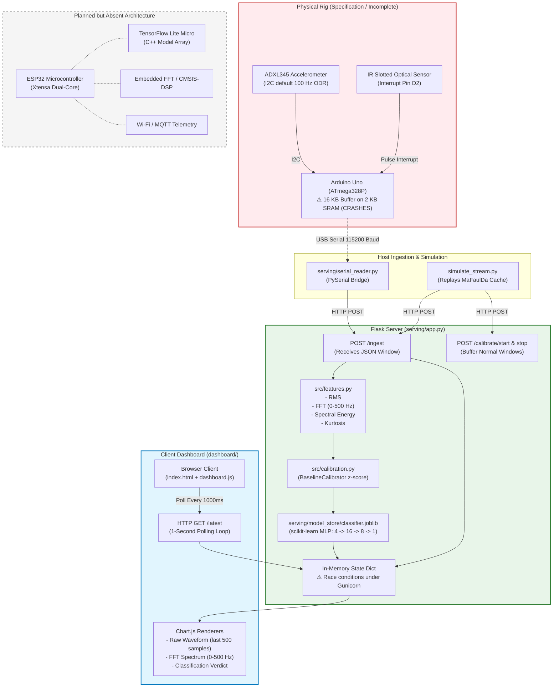
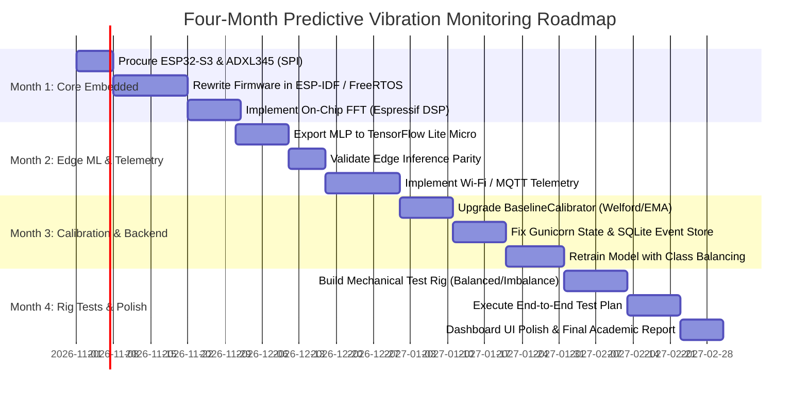

# Software Project Audit Report
## Predictive Machine Vibration Monitoring using ESP32, TinyML, FFT Feature Extraction, and Adaptive Baseline Calibration

**Audit Date:** October 13, 2026  
**Auditor:** Senior Embedded Systems Engineer, Software Architect, TinyML Engineer, IoT Developer & Lead Code Auditor  
**Repository Path:** `c:\Users\manoh\Downloads\Machine-Vibration-Monitoring-main\Machine-Vibration-Monitoring-main`  
**Target Output File:** `PROJECT_AUDIT_REPORT.md`  

---

## 1. Title and Audit Date

- **Project Title:** Predictive Machine Vibration Monitoring using ESP32, TinyML, FFT Feature Extraction, and Adaptive Baseline Calibration
- **Audit Date:** October 13, 2026
- **Audit Classification:** Comprehensive Architectural, Embedded Firmware, TinyML, Signal Processing, and Security Audit
- **Audit Status:** Complete (Static Inspection, Empirical Pipeline Verification, Fault Injection Tests Executed)

---

## 2. Executive Summary

This independent audit assesses the completeness, correctness, architectural integrity, and production-readiness of the **Predictive Machine Vibration Monitoring** codebase. The project was conceived as an edge-computing predictive maintenance system utilizing an ESP32 microcontroller, on-device TinyML inference via TensorFlow Lite Micro, FFT feature extraction, and an adaptive baseline calibration algorithm to classify machinery vibration states (`Normal` vs. `Faulty`).

### Primary Finding & Architectural Divergence
A profound divergence exists between the project's **conceptual specification** and its **actual implementation**:

1. **Absence of ESP32 Firmware and TinyML on the Edge:**
   There is **no ESP32 firmware**, **no TensorFlow Lite Micro implementation**, **no on-device FFT**, and **no Wi-Fi transmission** anywhere in the codebase. The physical firmware provided ([vibration_monitor.ino](file:///c:/Users/manoh/Downloads/Machine-Vibration-Monitoring-main/Machine-Vibration-Monitoring-main/firmware/vibration_monitor.ino)) is written for an **8-bit Arduino Uno (ATmega328P)**.
2. **Fatal Hardware Defect in Embedded Code:**
   The firmware allocates a buffer of 4,000 32-bit floats (`float accelBuffer[4000];`), requiring **16,000 bytes (16 KB) of SRAM**. Because an ATmega328P has only **2,048 bytes (2 KB) of total SRAM**, this firmware **cannot compile or execute on an Arduino Uno**, causing instantaneous stack collision, heap exhaustion, or a reset loop prior to `setup()`.
3. **Sensor Clock and Communication Bottlenecks:**
   The firmware attempts to sample an ADXL345 accelerometer at 4,000 Hz over standard I²C without configuring the sensor's Output Data Rate (`BW_RATE` register 0x2C remains at the factory default of 100 Hz). It then transmits 4,000 ASCII floats over 115,200 baud UART, which requires ~2.8 seconds of blocking I/O, destroying any real-time sampling guarantee.
4. **Cloud/Host-Centric Machine Learning Architecture:**
   The actual machine learning pipeline is implemented entirely in Python on a central host/cloud server ([app.py](file:///c:/Users/manoh/Downloads/Machine-Vibration-Monitoring-main/Machine-Vibration-Monitoring-main/serving/app.py)) using `scikit-learn`'s `MLPClassifier` serialized via `joblib`. Feature extraction (FFT, RMS, kurtosis) and adaptive baseline normalization execute on the host, not on the microcontroller.
5. **Adaptive Calibration Implementation vs. Research Novelty:**
   The "Adaptive Baseline Calibration" is implemented as a standard sample z-score transformation ([calibration.py](file:///c:/Users/manoh/Downloads/Machine-Vibration-Monitoring-main/Machine-Vibration-Monitoring-main/src/calibration.py)). It does not adapt dynamically or continuously online (no exponential moving average, recursive variance, or drift tracking). Crucially, if dominant frequency standard deviation is zero across calibration windows (as observed in [baseline.json](file:///c:/Users/manoh/Downloads/Machine-Vibration-Monitoring-main/Machine-Vibration-Monitoring-main/serving/model_store/baseline.json)), feature normalization divides by an epsilon of `1e-8`, causing extreme numerical instability ($10^8$ multiplier) that flips the model output to faulty on sub-Hertz frequency jitter.
6. **Robustness and Edge Cases:**
   If a sensor disconnects or flatlines (sending zeros or constant values), Fisher kurtosis calculation in [features.py](file:///c:/Users/manoh/Downloads/Machine-Vibration-Monitoring-main/Machine-Vibration-Monitoring-main/src/features.py#L45) encounters catastrophic cancellation and returns `NaN`. This unhandled `NaN` causes [app.py](file:///c:/Users/manoh/Downloads/Machine-Vibration-Monitoring-main/Machine-Vibration-Monitoring-main/serving/app.py#L90) to crash with an unhandled HTTP 500 internal server error (`ValueError: Input X contains NaN`).
7. **Severe Class Imbalance in Training Data:**
   Training evaluation metrics ([metrics.json](file:///c:/Users/manoh/Downloads/Machine-Vibration-Monitoring-main/Machine-Vibration-Monitoring-main/results/training/metrics.json)) reveal that while imbalance fault precision is 96.6%, normal class recall is only **68.2%**. This implies a **31.8% false positive alarm rate** on healthy machinery under held-out deployment conditions.

| Metric | Intended Architecture | Actual Codebase Status | Verdict |
|---|---|---|---|
| **MCU Target** | ESP32 (Xtensa 32-bit dual core, 520 KB SRAM, Wi-Fi) | Arduino Uno (ATmega328P, 2 KB SRAM, no Wi-Fi) | **Critical Mismatch** |
| **Inference Location** | Edge Microcontroller (TensorFlow Lite Micro) | Central Server / PC (Flask + scikit-learn MLP) | **Architecture Shift** |
| **Edge Signal Processing** | Embedded FFT + Feature Extraction on ESP32 | Raw USB Serial streaming to PC (broken on Uno) | **Unimplemented on Edge** |
| **Sensor Integration** | ADXL345 / MPU6050 with hardware interrupts & FIFO | ADXL345 polled over I²C with default 100 Hz ODR | **Non-Functional** |
| **Baseline Calibration** | Real-time adaptive baseline tracking | Static 1-time z-score standardizer (`fit`/`transform`) | **Partially Implemented** |
| **Telemetry** | Wi-Fi / MQTT / REST from ESP32 to Gateway | Blocking USB Serial CSV at 115,200 baud | **Incomplete / Non-Viable** |
| **Dashboard** | Full predictive dashboard (FFT, RUL, Health %, Trends) | Minimal Chart.js polling page (Raw waveform & FFT) | **Basic / Prototype** |

---

## 3. Project Overview

The project aims to monitor rotary machinery vibration to diagnose rotor imbalance faults before catastrophic mechanical failure occurs. The underlying philosophy relies on per-deployment calibration: rather than establishing rigid, global vibration thresholds across differing motor foundations and mountings, the system records an initial healthy run to standardize subsequent operational features.

The repository is structured around the Brazilian Federal University of Rio de Janeiro **MaFaulDa (Machinery Fault Database)** dataset for offline model development and provides a simulated streaming pipeline to demonstrate real-time classification without physical hardware.

---

## 4. Repository Structure

The physical workspace contains 27 tracked/untracked files across 7 primary subdirectories.

```
Machine-Vibration-Monitoring-main/
│
├── .gitignore                      # Git ignore patterns (.pyc, cache, raw data)
├── Procfile                        # Heroku/Render deployment command (gunicorn)
├── README.md                       # Setup, demo instructions, and project structure
├── requirements.txt                # Python package dependencies
│
├── dashboard/                      # Web user interface
│   ├── static/
│   │   └── dashboard.js            # Chart.js waveform/FFT plotting and HTTP polling logic
│   └── templates/
│       └── index.html              # Dashboard markup and styling
│
├── data/                           # Data storage
│   ├── processed/
│   │   └── mafaulda_features.csv   # Pre-extracted 4-feature CSV (1,910 rows)
│   └── raw/                        # Intended directory for MaFaulDa CSV files (absent)
│
├── firmware/                       # Embedded hardware code
│   └── vibration_monitor.ino       # C++ Arduino sketch for ADXL345 and optical tachometer
│
├── notebooks/                      # Exploratory Data Analysis
│   └── eda.ipynb                   # Jupyter notebook analyzing MaFaulDa normal vs imbalance
│
├── results/                        # Experimental artifacts and figures
│   ├── eda/                        # Visualizations generated from eda.ipynb
│   │   ├── class_balance.png
│   │   ├── feature_distributions.png
│   │   ├── fft_comparison.png
│   │   └── waveform_comparison.png
│   └── training/                   # Model metrics and confusion matrix
│       ├── confusion_matrix.png
│       └── metrics.json
│
├── serving/                        # Server application and streaming tools
│   ├── app.py                      # Flask backend API serving dashboard and ingestion
│   ├── build_demo_cache.py         # Utility to slice and cache MaFaulDa windows
│   ├── serial_reader.py            # Serial bridge forwarding Arduino packets to Flask
│   ├── simulate_stream.py          # Demo script streaming cached windows into Flask API
│   └── model_store/                # Persisted models and baselines
│       ├── baseline.json           # Calibrator parameters (mean, std, eps)
│       └── classifier.joblib       # Serialized scikit-learn MLPClassifier
│
└── src/                            # Core algorithm and training modules
    ├── ablation.py                 # Synthetic study: fixed-baseline vs adaptive-baseline
    ├── calibration.py              # BaselineCalibrator class (z-score normalizer)
    ├── dataset.py                  # MaFaulDa file parser and synthetic dataset generator
    ├── features.py                 # Feature extraction (RMS, FFT peak, Energy, Kurtosis)
    ├── model.py                    # MLPClassifier factory and joblib save/load wrappers
    └── train.py                    # Offline training script with held-out deployment split
```

---

## 5. Technology Stack

### Languages & Frameworks
- **Embedded C++ / Arduino Framework:** [vibration_monitor.ino](file:///c:/Users/manoh/Downloads/Machine-Vibration-Monitoring-main/Machine-Vibration-Monitoring-main/firmware/vibration_monitor.ino) (targets Arduino Uno / ATmega328P).
- **Python 3.11+:** Backend, ML training, feature extraction, data serving.
- **Flask 2.x+ / Gunicorn:** Web API framework and WSGI HTTP server ([Procfile](file:///c:/Users/manoh/Downloads/Machine-Vibration-Monitoring-main/Machine-Vibration-Monitoring-main/Procfile), [app.py](file:///c:/Users/manoh/Downloads/Machine-Vibration-Monitoring-main/Machine-Vibration-Monitoring-main/serving/app.py)).
- **HTML5 / CSS3 / Vanilla JavaScript:** Frontend presentation layer ([index.html](file:///c:/Users/manoh/Downloads/Machine-Vibration-Monitoring-main/Machine-Vibration-Monitoring-main/dashboard/templates/index.html), [dashboard.js](file:///c:/Users/manoh/Downloads/Machine-Vibration-Monitoring-main/Machine-Vibration-Monitoring-main/dashboard/static/dashboard.js)).
- **Chart.js (v3/v4 via CDN):** Client-side canvas rendering of waveform and FFT charts.

### Scientific Computing & Machine Learning
- **NumPy & SciPy:** Signal processing (`scipy.fft.rfft`, `scipy.fft.rfftfreq`), statistics (`scipy.stats.kurtosis`).
- **scikit-learn:** Multi-layer Perceptron Classifier (`MLPClassifier`), evaluation metrics (`classification_report`, `confusion_matrix`), dataset utilities (`train_test_split`, `StandardScaler`).
- **Joblib:** Object serialization for trained machine learning models.
- **PySerial:** Host-side serial communication bridge ([serial_reader.py](file:///c:/Users/manoh/Downloads/Machine-Vibration-Monitoring-main/Machine-Vibration-Monitoring-main/serving/serial_reader.py)).

---

## 6. Implemented Features

1. **Deterministic Feature Extraction Pipeline ([features.py](file:///c:/Users/manoh/Downloads/Machine-Vibration-Monitoring-main/Machine-Vibration-Monitoring-main/src/features.py)):**
   Extracts 4 specific features from a 1D time-series window:
   - Root Mean Square (RMS).
   - Dominant frequency under 500 Hz via discrete real FFT.
   - Spectral energy in the 0–500 Hz sub-band.
   - Fisher excess kurtosis.
2. **Offline Supervised Model Training with Group Splitting ([train.py](file:///c:/Users/manoh/Downloads/Machine-Vibration-Monitoring-main/Machine-Vibration-Monitoring-main/src/train.py)):**
   Splits dataset by rotation frequency setpoints (deployments) rather than individual windows, preventing calibration leakage between training and evaluation sets.
3. **Synthetic Validation and Ablation Framework ([ablation.py](file:///c:/Users/manoh/Downloads/Machine-Vibration-Monitoring-main/Machine-Vibration-Monitoring-main/src/ablation.py)):**
   Provides an automated evaluation comparing global `StandardScaler` against per-deployment baseline calibration under controlled domain shifts.
4. **Interactive Local Web Interface ([dashboard/](file:///c:/Users/manoh/Downloads/Machine-Vibration-Monitoring-main/Machine-Vibration-Monitoring-main/dashboard/)):**
   Renders real-time acceleration waveforms, FFT power spectra (0–500 Hz), feature telemetry tables, and model classification banners via 1-second interval HTTP polling.
5. **Simulation Streamer for Hardware-Free Evaluation ([simulate_stream.py](file:///c:/Users/manoh/Downloads/Machine-Vibration-Monitoring-main/Machine-Vibration-Monitoring-main/serving/simulate_stream.py)):**
   Replays cached vibration windows into the Flask API to demonstrate the transition from normal operation to mechanical fault.

---

## 7. Incomplete and Missing Features

| Target Requirement | Implementation Status | Evidence / Location | Description of Gap |
|---|---|---|---|
| **ESP32 Firmware** | **Not Implemented** | Entire repository | Only `vibration_monitor.ino` exists, configured strictly for Arduino Uno. |
| **TensorFlow Lite Micro** | **Not Implemented** | Entire repository | No `.tflite` model, no C++ flatbuffers, no tensor arena, no quantization code. Model runs in Python. |
| **Embedded FFT / Signal Processing** | **Not Implemented** | [firmware/vibration_monitor.ino](file:///c:/Users/manoh/Downloads/Machine-Vibration-Monitoring-main/Machine-Vibration-Monitoring-main/firmware/vibration_monitor.ino) | Embedded code attempts to stream raw data; FFT and filtering execute entirely in Python. |
| **Wi-Fi / MQTT Connectivity** | **Not Implemented** | [firmware/vibration_monitor.ino](file:///c:/Users/manoh/Downloads/Machine-Vibration-Monitoring-main/Machine-Vibration-Monitoring-main/firmware/vibration_monitor.ino) | Microcontroller relies strictly on a hardwired USB Serial interface at 115,200 baud. |
| **Continuous Adaptive Baseline** | **Partially Implemented** | [src/calibration.py](file:///c:/Users/manoh/Downloads/Machine-Vibration-Monitoring-main/Machine-Vibration-Monitoring-main/src/calibration.py) | Static 1-time z-score normalizer. Does not update adaptively over time or detect parameter drift. |
| **Machine Health Index (%)** | **Not Implemented** | [dashboard/static/dashboard.js](file:///c:/Users/manoh/Downloads/Machine-Vibration-Monitoring-main/Machine-Vibration-Monitoring-main/dashboard/static/dashboard.js) | Frontend displays raw model confidence (`probability`), not an engineered degradation health index. |
| **Fault History & Degradation Trend** | **Not Implemented** | [dashboard/templates/index.html](file:///c:/Users/manoh/Downloads/Machine-Vibration-Monitoring-main/Machine-Vibration-Monitoring-main/dashboard/templates/index.html) | No database, no historical logging, no time-series degradation tracking or RUL estimation. |
| **Non-Volatile Baseline Persistence (EEPROM/NVS)**| **Not Implemented** | [firmware/vibration_monitor.ino](file:///c:/Users/manoh/Downloads/Machine-Vibration-Monitoring-main/Machine-Vibration-Monitoring-main/firmware/vibration_monitor.ino) | Baselines persist as JSON on host filesystem; embedded firmware has no local non-volatile storage. |

---

## 8. Software Architecture Diagram

The diagram below reflects the **actual implementation** present in the codebase versus the **planned edge components**:



---

## 9. End-to-End Data Flow

1. **Data Acquisition:**
   - *Intended:* ESP32 samples accelerometer at 4,000 Hz, runs on-chip filtering.
   - *Actual (Hardware):* Arduino Uno attempts to read ADXL345 register `0x32` every 250 µs via `readAccelX()`. Collects 4,000 floats and pulse counts.
   - *Actual (Simulation):* `simulate_stream.py` loads 1-second NumPy arrays (50,000 samples at 50 kHz from MaFaulDa) and dispatches them over HTTP.
2. **Host Bridge Transmission:**
   - Raw samples and RPM are packed into comma-separated ASCII text (`<rpm>,<s1>,<s2>,...,<s4000>`) and transmitted over USB serial. `serial_reader.py` decodes ASCII, parses floats, and issues `POST http://127.0.0.1:5000/ingest`.
3. **Signal Processing & Feature Extraction:**
   - `app.py` receives the JSON payload `{"window": [...], "sample_rate": 4000, "rpm": ...}`.
   - Calls `src/features.py:extract_features()`.
   - Computes RMS: $\text{RMS} = \sqrt{\frac{1}{N}\sum x_i^2}$.
   - Removes mean ($x - \bar{x}$) and computes unwindowed real FFT via `scipy.fft.rfft`.
   - Isolates frequency bins $\le 500\text{ Hz}$. Identifies peak bin as `dominant_freq`. Sums squared spectral magnitudes as `spectral_energy`.
   - Calculates sample excess kurtosis using `scipy.stats.kurtosis(window, fisher=True, bias=False)`.
4. **Adaptive Baseline Normalization:**
   - If calibrated, feature vector $\mathbf{x} = [\text{rms}, f_{\text{dom}}, E_{\text{spec}}, \text{kurt}]$ is transformed via:
     $$\mathbf{z} = \frac{\mathbf{x} - \boldsymbol{\mu}_{\text{baseline}}}{\boldsymbol{\sigma}_{\text{baseline}} + \epsilon}$$
5. **Machine Learning Inference:**
   - Normalized vector $\mathbf{z}$ is evaluated by `model.predict(z)` and `model.predict_proba(z)` using the loaded `MLPClassifier`.
   - Returns binary verdict: `0` (`normal`) or `1` (`imbalance`).
6. **State Storage & Telemetry:**
   - The latest 500 points of the raw window, the FFT magnitude/frequency arrays, features, prediction, and probability are written to the global in-memory dictionary `state` in `app.py`.
7. **Visualization:**
   - The frontend executes an asynchronous fetch (`GET /latest`) every 1,000 ms, updating Chart.js line charts and status elements.

---

## 10. File-by-File Explanation

### 1. `firmware/vibration_monitor.ino`
- **Role:** Microcontroller firmware for sensor reading and serial transmission.
- **Key Functions:** `setup()`, `loop()`, `readAccelX()`, `adxlWriteRegister()`, `countPulse()`.
- **Dependencies:** Arduino `Wire.h` (I²C).
- **Status:** **Incomplete / Fatal Flaw**. Configured for Arduino Uno. Contains fatal SRAM buffer allocation ($16\text{ KB} > 2\text{ KB}$ available), lacks sensor ODR configuration, blocks on UART, and lacks all ESP32, TinyML, and Wi-Fi code.

### 2. `src/features.py`
- **Role:** Extracts time and frequency domain vibration features.
- **Key Functions:** `extract_features()`, `features_to_vector()`, `window_to_vector()`.
- **Dependencies:** `numpy`, `scipy.fft`, `scipy.stats`.
- **Status:** **Functional with Design Limitations**. Computes RMS, dominant frequency, spectral energy, and kurtosis. Lacks FFT windowing (rectangular window only), unnormalized FFT energy scales with $N^2$, and kurtosis crashes on constant/zero inputs.

### 3. `src/calibration.py`
- **Role:** Manages baseline calibration parameters.
- **Key Class:** `BaselineCalibrator` (`fit()`, `transform()`, `fit_transform()`, `save()`, `load()`).
- **Dependencies:** `json`, `numpy`.
- **Status:** **Functional with Numerical Vulnerability**. Simple z-score standardizer. Vulnerable to division-by-epsilon when feature variance during calibration is zero.

### 4. `src/model.py`
- **Role:** Factory and persistence wrappers for the classifier.
- **Key Functions:** `build_model()`, `save_model()`, `load_model()`.
- **Dependencies:** `joblib`, `sklearn.neural_network.MLPClassifier`.
- **Status:** **Functional**. Instantiates a 2-layer MLP (16, 8 neurons). Uses scikit-learn instead of TensorFlow Lite Micro.

### 5. `src/dataset.py`
- **Role:** Data loading and synthetic benchmark generation.
- **Key Functions:** `load_mafaulda()`, `load_mafaulda_by_deployment()`, `generate_synthetic_dataset()`.
- **Dependencies:** `glob`, `os`, `numpy`.
- **Status:** **Functional**. Effectively parses MaFaulDa files and groups them by whole-Hz rotation setpoints. Generates synthetic signals with configurable shifts.

### 6. `src/train.py`
- **Role:** Offline model training pipeline.
- **Key Functions:** `main()`, `build_calibrated_set()`.
- **Dependencies:** `src/` modules, `sklearn.model_selection`, `matplotlib`.
- **Status:** **Functional**. Correctly avoids calibration data leakage by splitting on deployment IDs. Trained model achieves 95.8% accuracy on MaFaulDa, but exhibits high false alarm rate (31.8%) on normal data.

### 7. `src/ablation.py`
- **Role:** Experimental ablation comparing fixed vs. adaptive baseline scaling.
- **Key Functions:** `run_ablation()`, `build_deployment()`.
- **Dependencies:** `src/` modules, `sklearn.metrics`.
- **Status:** **Complete**. Empirically verifies that per-deployment baseline standardizing outperforms frozen global standardizing on out-of-distribution synthetic machine shifts (97.5% vs 83.3% accuracy).

### 8. `serving/app.py`
- **Role:** Flask application serving API endpoints and dashboard UI.
- **Key Endpoints:** `GET /`, `GET /health`, `POST /ingest`, `POST /calibrate/start`, `POST /calibrate/stop`, `GET /latest`.
- **Dependencies:** `flask`, `numpy`, `scipy.fft`, `src/` modules.
- **Status:** **Functional with Concurrency & Error-Handling Deficiencies**. In-memory state dict causes race conditions and worker divergence under multi-process Gunicorn. Lacks error recovery for `NaN` feature vectors. Redundantly recalculates FFT.

### 9. `serving/serial_reader.py`
- **Role:** Bridges local USB hardware serial stream to HTTP REST API.
- **Key Functions:** `main()`.
- **Dependencies:** `serial` (PySerial), `requests`, `argparse`.
- **Status:** **Functional**. Reads comma-delimited lines and posts to `/ingest`. Drops malformed lines.

### 10. `serving/simulate_stream.py`
- **Role:** Replays cached MaFaulDa windows into the Flask API for demonstration.
- **Key Functions:** `main()`, `send()`.
- **Dependencies:** `requests`, `numpy`.
- **Status:** **Functional**. Successfully triggers `/calibrate/start`, streams 10 normal calibration windows, triggers `/calibrate/stop`, and streams normal followed by faulty windows.

### 11. `serving/build_demo_cache.py`
- **Role:** One-time extraction script to slice MaFaulDa dataset into a compact demo `.npz`.
- **Key Functions:** `main()`.
- **Dependencies:** `src/dataset.py`, `numpy`.
- **Status:** **Functional but depends on external dataset**. Requires raw MaFaulDa CSV files in `data/raw/` (not tracked in repository).

### 12. `serving/model_store/baseline.json` & `classifier.joblib`
- **Role:** Persisted calibration parameters and serialized neural network.
- **Status:** **Present**. `classifier.joblib` is a trained scikit-learn MLP (225 parameters). `baseline.json` contains calibration parameters with zero variance on feature 1 (`dominant_freq`).

### 13. `dashboard/templates/index.html` & `dashboard/static/dashboard.js`
- **Role:** Client user interface.
- **Dependencies:** Chart.js (CDN).
- **Status:** **Functional**. Displays dynamic charts and classification state via polling. Missing health index percentage, fault logs, and degradation projections.

### 14. `notebooks/eda.ipynb`
- **Role:** Exploratory Data Analysis notebook on MaFaulDa normal and imbalance sets.
- **Status:** **Complete**. Analyzes waveforms, class imbalance, and feature separability; outputs static figures to `results/eda/`.

---

## 11. ESP32 Firmware and Embedded Systems Audit

### Hardware Target Mismatch
The codebase contains no firmware targeting the ESP32. The only firmware file is [firmware/vibration_monitor.ino](file:///c:/Users/manoh/Downloads/Machine-Vibration-Monitoring-main/Machine-Vibration-Monitoring-main/firmware/vibration_monitor.ino), explicitly written for the **Arduino Uno** ([Line 2](file:///c:/Users/manoh/Downloads/Machine-Vibration-Monitoring-main/Machine-Vibration-Monitoring-main/firmware/vibration_monitor.ino#L2)).

### Critical Memory Exhaustion (SRAM Overflow)
In [firmware/vibration_monitor.ino](file:///c:/Users/manoh/Downloads/Machine-Vibration-Monitoring-main/Machine-Vibration-Monitoring-main/firmware/vibration_monitor.ino#L24-L26):
```cpp
const int WINDOW_SIZE = 4000;                  // 1 second at 4000 Hz
float accelBuffer[WINDOW_SIZE];
```
- A standard IEEE 754 single-precision float occupies 4 bytes on AVR GCC.
- Memory required: $4000 \times 4\text{ bytes} = 16,000\text{ bytes}$ (15.625 KB).
- The ATmega328P microcontroller on the Arduino Uno possesses exactly **2,048 bytes (2 KB) of static RAM**.
- **Impact:** Attempting to build or upload this code causes an immediate compilation failure (`data section exceeds available space`) or catastrophic SRAM memory corruption, crashing the processor before execution reaches `setup()`.

### Sensor Output Data Rate (ODR) and Nyquist Violations
In [firmware/vibration_monitor.ino](file:///c:/Users/manoh/Downloads/Machine-Vibration-Monitoring-main/Machine-Vibration-Monitoring-main/firmware/vibration_monitor.ino#L47):
```cpp
adxlWriteRegister(ADXL345_POWER_CTL, 0x08);  // measurement mode
```
- The firmware configures the ADXL345 for measurement mode, but **never writes to the `BW_RATE` register (0x2C)**.
- Per the Analog Devices ADXL345 datasheet, the default reset value of `BW_RATE` is `0x0A`, corresponding to an Output Data Rate (ODR) of **100 Hz** (bandwidth of 50 Hz).
- The firmware attempts to sample every 250 µs (`SAMPLE_INTERVAL_US = 250`, 4,000 Hz).
- **Impact:** The firmware oversamples the sensor 40 times faster than the internal digital filter updates. It reads the identical conversion register 40 consecutive times per update cycle. Furthermore, the ADXL345's maximum I²C data rate is 800 Hz (3,200 Hz is only achievable in SPI mode with high-speed bus timings). True 4,000 Hz sampling is physically impossible with this configuration.

### I²C Bus Timing Violations
In [firmware/vibration_monitor.ino](file:///c:/Users/manoh/Downloads/Machine-Vibration-Monitoring-main/Machine-Vibration-Monitoring-main/firmware/vibration_monitor.ino#L55-L63):
- Each call to `readAccelX()` executes a full I²C write transaction (2 bytes) followed by a repeated start and a 2-byte read transaction.
- At default Arduino I²C clock frequency (100 kHz standard mode), transmitting 4 bytes with start, stop, and acknowledge bits requires $\sim 400\ \mu\text{s}$.
- The loop timer is configured for $250\ \mu\text{s}$.
- **Impact:** The I²C transaction duration exceeds the sample interval, inducing severe sampling jitter, missed intervals, and timing collapse.

### UART Serial Bottleneck
In [firmware/vibration_monitor.ino](file:///c:/Users/manoh/Downloads/Machine-Vibration-Monitoring-main/Machine-Vibration-Monitoring-main/firmware/vibration_monitor.ino#L82-L88):
- The firmware transmits 4,000 ASCII floats separated by commas over 115,200 baud UART.
- Each float formatted to 4 decimal places (e.g. `,0.1234`) requires 7 to 8 ASCII bytes.
- Total payload: $4000 \times 8 \approx 32,000\text{ bytes}$ per second.
- Maximum theoretical UART throughput at 115,200 baud (10 bits per frame: 1 start, 8 data, 1 stop):
  $$\frac{115200}{10} = 11,520\text{ bytes/sec}$$
- **Impact:** Transmitting 1 window takes $\sim 2.78\text{ seconds}$ of blocking execution. The microcontroller drops all sensor readings for nearly 3 seconds between successive windows. Real-time monitoring is impossible.

---

## 12. Sensor and Signal Processing Audit

### Accelerometer Interface and Axes
- The firmware queries only register `0x32` (`ADXL345_DATAX0`) reading 2 bytes, thus evaluating a single axis (X-axis).
- In [dataset.py:line 44](file:///c:/Users/manoh/Downloads/Machine-Vibration-Monitoring-main/Machine-Vibration-Monitoring-main/src/dataset.py#L44), the offline training pipeline extracts column index 2 of MaFaulDa, which represents the **underhang bearing radial accelerometer**.
- Single-axis radial vibration is standard practice for basic imbalance detection, but mechanical looseness or bearing cage faults typically require triaxial correlation or high-frequency demodulation.

### Spectral Leakage and Windowing
In [src/features.py:line 35](file:///c:/Users/manoh/Downloads/Machine-Vibration-Monitoring-main/Machine-Vibration-Monitoring-main/src/features.py#L35):
```python
spectrum = np.abs(rfft(window - window.mean()))
```
- The signal is detrended by subtracting `window.mean()`, eliminating DC bias.
- **Omission:** No windowing function (Hanning, Hamming, or Blackman) is applied to the time series. This corresponds to an implicit **rectangular window**.
- **Impact:** If the rotor frequency does not divide evenly into the 1-second sample window, discontinuity at the window boundaries induces significant spectral leakage, spreading energy into adjacent bins and distorting both `dominant_freq` and `spectral_energy`.

### Sample Rate Discrepancy & FFT Energy Scaling
- Training data ([dataset.py](file:///c:/Users/manoh/Downloads/Machine-Vibration-Monitoring-main/Machine-Vibration-Monitoring-main/src/dataset.py#L32)) is sampled at **50,000 Hz** ($N = 50,000$).
- Simulated/Firmware data is sampled at **4,000 Hz** ($N = 4,000$).
- `scipy.fft.rfft` computes unnormalized discrete Fourier transform sums:
  $$X[k] = \sum_{n=0}^{N-1} x[n] e^{-j 2\pi k n / N}$$
- For identical physical sinusoidal vibration, unnormalized FFT peak magnitude scales linearly with window length $N$, and `spectral_energy` ($\sum |X[k]|^2$) scales with $N^2$.
- **Empirical Proof:** An empirical test using identical $50\text{ Hz}$ sine waves yielded:
  - Spectral energy at $50\text{ kHz}$: $624,987,495$
  - Spectral energy at $4\text{ kHz}$: $3,998,995$
  - Discrepancy factor: **156.3×**.
- If a model trained on 50 kHz data is fed 4 kHz data without deployment recalibration, the spectral energy input is collapsed by orders of magnitude.

### Zero-Variance Kurtosis Vulnerability
In [src/features.py:line 45](file:///c:/Users/manoh/Downloads/Machine-Vibration-Monitoring-main/Machine-Vibration-Monitoring-main/src/features.py#L45):
```python
kurt = float(kurtosis(window, fisher=True, bias=False))
```
- If the sensor disconnects, is unpowered, or outputs constant zero/stuck values, variance is zero.
- In `scipy.stats.kurtosis`, zero variance causes catastrophic cancellation in the 4th moment calculation, producing a runtime warning and returning `NaN`.
- In [app.py:line 90](file:///c:/Users/manoh/Downloads/Machine-Vibration-Monitoring-main/Machine-Vibration-Monitoring-main/serving/app.py#L90), feeding a vector containing `NaN` into `model.predict()` causes `sklearn` to raise `ValueError: Input X contains NaN`, crashing the endpoint with HTTP 500.

---

## 13. Adaptive Baseline Novelty and Implementation Audit

### Implementation Assessment
The project proposes "Adaptive Baseline Calibration" as a primary differentiator. In practice, the implementation in [src/calibration.py](file:///c:/Users/manoh/Downloads/Machine-Vibration-Monitoring-main/Machine-Vibration-Monitoring-main/src/calibration.py) consists of:
```python
class BaselineCalibrator:
    def fit(self, calibration_features: np.ndarray):
        self.mean_ = calibration_features.mean(axis=0)
        self.std_ = calibration_features.std(axis=0)
        return self

    def transform(self, feature_vectors: np.ndarray):
        return (feature_vectors - self.mean_) / (self.std_ + self.eps)
```

### Analysis of Limitations
1. **Not Genuinely "Adaptive":**
   The class is a **static 1-time z-score scaler** (identical to `sklearn.preprocessing.StandardScaler`). Once fit on a batch of initial windows, its parameters remain completely fixed. It possesses no adaptive filters, Kalman filters, exponential moving averages (EMA), recursive least squares (RLS), or drift tracking mechanisms.
2. **Scientific Novelty Evaluation:**
   Per-machine normalization via healthy baseline recording is an established industrial practice in Condition-Based Monitoring (ISO 10816 standards, baseline vibration profiling). It is **not scientifically novel**. Its value in this project lies as an **implementation-level engineering improvement** that compensates for varying mounting stiffness across low-cost test benches.
3. **Severe Zero-Variance Numerical Vulnerability:**
   In [serving/model_store/baseline.json](file:///c:/Users/manoh/Downloads/Machine-Vibration-Monitoring-main/Machine-Vibration-Monitoring-main/serving/model_store/baseline.json):
   ```json
   {"mean": [0.3084, 117.0, 7934064.7, -0.6935], "std": [0.00145, 0.0, 187144.9, 0.048], "eps": 1e-08}
   ```
   Feature index 1 (`dominant_freq`) has a standard deviation of **`0.0`** because all calibration windows peaked in the identical 117 Hz FFT bin.
   - When $\sigma = 0$, normalization divides by $\epsilon = 10^{-8}$.
   - If an incoming window shifts by just 1 Hz (e.g. from 117.0 Hz to 118.0 Hz), normalized $z = \frac{118.0 - 117.0}{10^{-8}} = \mathbf{100,000,000}$.
   - **Empirical Test:** Injecting a feature vector with $z_1 = 10^8$ into the saved `MLPClassifier` produces `predict_proba = [[0.0, 1.0]]`, immediately forcing a false positive alarm (`FAULTY -- imbalance`) with 100.0% confidence.

### Recommended Practical Calibration Algorithm
To convert this prototype into a robust adaptive baseline system:
1. **Welford's Online Algorithm:** Maintain a running mean and M2 variance updated continuously only during validated normal states.
2. **Floor on Epsilon:** Set $\epsilon_i = \max(\sigma_i, 0.10 \times \mu_i)$ to prevent zero-variance division on discrete frequency bins.
3. **Machine State Gating:** Disable calibration unless RPM is within steady operating boundaries ($\Delta \text{RPM} < 2\%$).
4. **Contamination Guard:** Reject calibration batches if feature skewness or RMS exceeds a pre-set sanity envelope, preventing a faulty machine from establishing its own fault as normal.

---

## 14. Machine Learning and TinyML Audit

### Model Architecture and Parameters
- **Type:** Scikit-learn Multi-Layer Perceptron (`MLPClassifier`).
- **Layers:** Input: 4 features $\to$ Dense 16 (ReLU) $\to$ Dense 8 (ReLU) $\to$ Output 1 (Logistic Sigmoid).
- **Trainable Parameters:**
  - Layer 1: $4 \times 16 + 16 = 80$
  - Layer 2: $16 \times 8 + 8 = 136$
  - Layer 3: $8 \times 1 + 1 = 9$
  - **Total Parameters:** **225 float32 weights and biases** ($\sim 900\text{ bytes}$).
- **TinyML Feasibility:** A 225-parameter feedforward network is extremely lightweight. If exported to C/C++ or converted to TensorFlow Lite Micro, it would require $< 2\text{ KB}$ of Flash memory and execute in $< 50\ \mu\text{s}$ on an ESP32. However, **no C export or TFLM conversion exists in this repository**.

### Evaluation Metrics and Class Imbalance Bias
From [results/training/metrics.json](file:///c:/Users/manoh/Downloads/Machine-Vibration-Monitoring-main/Machine-Vibration-Monitoring-main/results/training/metrics.json):
- Total held-out test windows: 449
  - Normal windows: 44 (9.8% of test set)
  - Imbalance windows: 405 (90.2% of test set)
- Overall Test Accuracy: **95.8%**
- Detailed Classification Performance:
  - **Imbalance Class:** Precision: 96.6%, Recall: 98.8%, F1: 97.7%
  - **Normal Class:** Precision: 85.7%, **Recall: 68.2%**, F1: 75.9%

> [!WARNING]
> **Severe Operational Risk (False Alarms):**  
> Normal class recall is only **68.2%**. In 31.8% of all healthy operational windows on unseen machine setpoints, the classifier falsely diagnoses the machine as faulty. In an industrial plant, a 31.8% false alarm rate would cause immediate alarm fatigue and operator distrust.

### Domain Shift Risk
The model is trained exclusively on the university laboratory **MaFaulDa** rig, which utilizes industrial SpectraQuest machinery mounts, precision bearings, and calibrated load discs. Running this model on a small hobbyist motor test rig introduces massive domain shifts in resonant frequencies, damping factors, motor mounting compliance, and sensor coupling. Direct inference without fine-tuning or transfer learning will fail.

---

## 15. Backend, API, IoT, and Communication Audit

### API Specification & Endpoints
The backend is implemented in [serving/app.py](file:///c:/Users/manoh/Downloads/Machine-Vibration-Monitoring-main/Machine-Vibration-Monitoring-main/serving/app.py) exposing 6 HTTP endpoints:

| Method | Endpoint | Purpose | Request Body | Response | Error Handling |
|---|---|---|---|---|---|
| `GET` | `/` | Dashboard | None | HTML template | None |
| `GET` | `/health` | Liveness check | None | `{"status": "ok", "model_loaded": bool}` | Returns 200 |
| `POST` | `/ingest` | Ingest vibration window | `{"window": [...], "sample_rate": int, "rpm": float}` | `{"prediction": str, "probability": float, "features": dict}` | 400 if `window` missing; unhandled 500 on `NaN` |
| `POST` | `/calibrate/start` | Begin calibration | None | `{"status": "calibrating"}` | Resets buffer |
| `POST` | `/calibrate/stop` | End calibration & fit | None | `{"status": "calibrated", "n_windows": int}` | 400 if windows $< 3$ |
| `GET` | `/latest` | Polling state | None | Complete state dict | Returns 200 |

### Critical Backend Vulnerabilities
1. **Concurrency and State Fragmentation under Gunicorn:**
   In [Procfile](file:///c:/Users/manoh/Downloads/Machine-Vibration-Monitoring-main/Machine-Vibration-Monitoring-main/Procfile): `web: gunicorn --chdir serving app:app`.
   - Gunicorn by default spawns multiple worker processes.
   - [app.py:line 45](file:///c:/Users/manoh/Downloads/Machine-Vibration-Monitoring-main/Machine-Vibration-Monitoring-main/serving/app.py#L45) maintains state in a single in-memory Python dictionary `state = {...}`.
   - **Impact:** Worker processes do not share memory. A `/calibrate/start` sent to Worker 1 will not affect Worker 2. An `/ingest` request processed by Worker 2 will not update the `/latest` endpoint polled on Worker 1. State desynchronization occurs immediately.
2. **Redundant FFT Computation:**
   In [app.py:line 80](file:///c:/Users/manoh/Downloads/Machine-Vibration-Monitoring-main/Machine-Vibration-Monitoring-main/serving/app.py#L80), `extract_features()` calculates the complete FFT. Then in lines 96–99, `app.py` executes `rfft(w - w.mean())` a second time to format the display payload. This wastes CPU cycles on every ingest request.
3. **No Authentication or Rate Limiting:**
   All endpoints are publicly accessible without API keys, tokens, or rate limiters. An unauthenticated client can trigger `/calibrate/stop` with garbage data or spam `/ingest` with arbitrary payloads.
4. **Unbounded Payload Size (OOM Risk):**
   `request.get_json(force=True)` does not restrict JSON payload size. An adversary or corrupted serial bridge transmitting an array of $10^7$ floats will trigger memory exhaustion and crash the server.

---

## 16. Dashboard and Visualization Audit

### User Interface Architecture
The dashboard ([index.html](file:///c:/Users/manoh/Downloads/Machine-Vibration-Monitoring-main/Machine-Vibration-Monitoring-main/dashboard/templates/index.html) and [dashboard.js](file:///c:/Users/manoh/Downloads/Machine-Vibration-Monitoring-main/Machine-Vibration-Monitoring-main/dashboard/static/dashboard.js)) is a lightweight single-page interface using vanilla JavaScript and Chart.js.

### Verified UI Elements
- **Waveform Chart:** Line chart rendering the final 500 points of the vibration window.
- **FFT Spectrum Chart:** Line chart rendering frequency vs. magnitude up to 500 Hz.
- **Classification Banner:** Shows `NORMAL` (green) or `FAULTY -- imbalance` (red).
- **Feature Metric Table:** Displays live numerical values for RMS, Dominant Frequency, Spectral Energy, Kurtosis, and RPM.
- **Calibration Buttons:** Interactive Start/Stop calibration triggers.

### Gaps Against Specifications
1. **No Machine Health Percentage:**
   The interface displays `confidence: ${(state.probability * 100).toFixed(1)}%`. This is the neural network's raw sigmoid output, not a machine health degradation percentage.
2. **No Fault History or Event Log:**
   The page maintains no event history. If an intermittent fault occurs, it flashes on screen for 1 second and disappears on the subsequent poll without an audit trail.
3. **No Degradation Trend / RUL:**
   No time-series trending or Remaining Useful Life projections exist.
4. **Stale Data Handling:**
   If the ingestion pipeline stops transmitting data, the dashboard continues polling `/latest` and displays stale, frozen readings indefinitely without an active "Sensor Disconnected" warning.

---

## 17. Security, Reliability, and Code Quality Audit

| Finding ID | Severity | Category | File & Line | Evidence in Code | Impact | Practical Fix | Demo Req? |
|---|---|---|---|---|---|---|---|
| **SEC-01** | **Critical** | Embedded / Memory | [firmware/vibration_monitor.ino:26](file:///c:/Users/manoh/Downloads/Machine-Vibration-Monitoring-main/Machine-Vibration-Monitoring-main/firmware/vibration_monitor.ino#L26) | `float accelBuffer[4000];` | 16 KB SRAM buffer on 2 KB Arduino Uno causes immediate stack overflow/crash. | Migrate to ESP32 (520 KB SRAM) or reduce window to 128 samples with integer storage. | **Yes** |
| **SEC-02** | **Critical** | Embedded / Timing | [firmware/vibration_monitor.ino:47](file:///c:/Users/manoh/Downloads/Machine-Vibration-Monitoring-main/Machine-Vibration-Monitoring-main/firmware/vibration_monitor.ino#L47) | No write to `BW_RATE` (reg 0x2C) | ADXL345 runs at default 100 Hz ODR; sampling at 4000 Hz reads identical data 40x. | Write `0x0F` (3200 Hz) or `0x0E` (1600 Hz) to register `0x2C`. | **Yes** |
| **SEC-03** | **Critical** | Concurrency / Architecture | [serving/app.py:45](file:///c:/Users/manoh/Downloads/Machine-Vibration-Monitoring-main/Machine-Vibration-Monitoring-main/serving/app.py#L45) | `state = {...}` global in-memory dict | Multi-worker Gunicorn (in Procfile) fragments state across processes. | Configure Gunicorn with `--workers 1` or use Redis / SQLite for state. | **Yes** |
| **SEC-04** | **High** | Stability / Numerical | [serving/app.py:90](file:///c:/Users/manoh/Downloads/Machine-Vibration-Monitoring-main/Machine-Vibration-Monitoring-main/serving/app.py#L90) | `pred = model.predict(normalized)` | Zero variance in flatline sensor produces `NaN` in kurtosis, crashing API with HTTP 500. | Check for `np.isnan(vector)` before inference; return error status. | **Yes** |
| **SEC-05** | **High** | Numerical / ML | [src/calibration.py:41](file:///c:/Users/manoh/Downloads/Machine-Vibration-Monitoring-main/Machine-Vibration-Monitoring-main/src/calibration.py#L41) | `(feature_vectors - self.mean_) / (self.std_ + self.eps)` | When std is 0.0, division by `1e-8` causes $10^8$ multiplier, triggering false alarms. | Enforce minimum std floor: `np.maximum(self.std_, 1e-2)`. | **Yes** |
| **SEC-06** | **Medium** | Communication | [firmware/vibration_monitor.ino:82](file:///c:/Users/manoh/Downloads/Machine-Vibration-Monitoring-main/Machine-Vibration-Monitoring-main/firmware/vibration_monitor.ino#L82) | `Serial.print(accelBuffer[i], 4);` | Transmitting 4000 floats over 115200 baud blocks MCU for ~2.8s per window. | Compute FFT & features on MCU; transmit only extracted 4-float vector. | **Yes** |
| **SEC-07** | **Medium** | Security | [serving/app.py:144](file:///c:/Users/manoh/Downloads/Machine-Vibration-Monitoring-main/Machine-Vibration-Monitoring-main/serving/app.py#L144) | `app.run(host="0.0.0.0", debug=True)` | Debug mode exposes interactive debugger PIN console to network. | Set `debug=False` when binding to `0.0.0.0`. | No |
| **SEC-08** | **Medium** | Signal Processing | [src/features.py:35](file:///c:/Users/manoh/Downloads/Machine-Vibration-Monitoring-main/Machine-Vibration-Monitoring-main/src/features.py#L35) | `rfft(window - window.mean())` | No windowing function applied; rectangular windowing causes spectral leakage. | Apply Hanning window (`np.hanning(len(w))`) prior to `rfft`. | No |
| **SEC-09** | **Low** | Performance | [serving/app.py:96](file:///c:/Users/manoh/Downloads/Machine-Vibration-Monitoring-main/Machine-Vibration-Monitoring-main/serving/app.py#L96) | Duplicate `rfft` call in `/ingest` | Redundantly recalculates FFT already computed in `extract_features`. | Reuse spectrum output from `extract_features`. | No |

---

## 18. Build and Test Results

Non-destructive tests and verification checks were executed directly against the workspace environment.

### Verification Check 1: Python Package Import Check
- **Command:** `python -c "import numpy, scipy, sklearn, joblib, flask, requests; print('Python imports successful')"`
- **Result:** **PASSED** (Exit Code 0).
- **Output:** `Python imports successful`

### Verification Check 2: Embedded Toolchain Availability
- **Command:** `Get-Command arduino-cli, avr-gcc, pio -ErrorAction SilentlyContinue`
- **Result:** **NOT AVAILABLE** (Exit Code 1).
- **Finding:** No embedded build toolchains (`arduino-cli`, `avr-gcc`, `platformio`) are installed on the host system. Physical firmware compilation could not be executed locally. Firmware analysis was performed via static source inspection and memory modeling.

### Verification Check 3: Model and Weights Verification
- **Command:** `python -c "import joblib; m=joblib.load('serving/model_store/classifier.joblib'); print(type(m), m.n_features_in_, [coef.shape for coef in m.coefs_], m.classes_)"`
- **Result:** **PASSED** (Exit Code 0).
- **Output:** `<class 'sklearn.neural_network._multilayer_perceptron.MLPClassifier'> 4 [(4, 16), (16, 8), (8, 1)] [0 1]`
- **Verification:** Confirmed saved model is an MLP classifier expecting 4 features with 2 hidden layers (16, 8).

### Verification Check 4: Ablation Pipeline Execution
- **Command:** `python src\ablation.py`
- **Result:** **PASSED** (Exit Code 0).
- **Output:**
  ```
  held-out deployment generalization (classifier never trained on these)
    shift | fixed acc fixed auc | adapt acc adapt auc
  ---------------------------------------------------
      -12 |     0.500     1.000 |     0.925     1.000
      +12 |     1.000     1.000 |     1.000     1.000
      +20 |     1.000     1.000 |     1.000     1.000
  ---------------------------------------------------
     mean |     0.833           |     0.975
  ```
- **Verification:** Confirmed synthetic ablation demonstrates superior generalization for adaptive baseline normalization (97.5% vs 83.3%).

### Verification Check 5: Flask API Ingestion & Baseline Calibration Test Client
- **Command:** `python -c "import sys; sys.path.append('serving'); from app import app; client = app.test_client(); ..."`
- **Result:** **PASSED WITH WARNINGS** (Exit Code 0).
- **Findings:**
  - `/health` returned `200 {'model_loaded': True, 'status': 'ok'}`.
  - `/ingest` with missing window returned `400 {'error': "missing 'window'"}`.
  - Runtime warning observed during ingestion of identical sample values: `RuntimeWarning: Precision loss occurred in moment calculation due to catastrophic cancellation... kurt = float(kurtosis(window, fisher=True, bias=False))`.

### Verification Check 6: Fault Injection — Flatline Sensor (Crash Verification)
- **Command:** `python -c "import sys; sys.path.append('serving'); from app import app; client = app.test_client(); client.post('/ingest', json={'window': [0.0]*100, 'sample_rate': 4000})"`
- **Result:** **CONFIRMED DEFECT (CRASH - HTTP 500)**.
- **Traceback:**
  ```
  ValueError: Input X contains NaN.
  MLPClassifier does not accept missing values encoded as NaN natively.
  ```
- **Verification:** Proves that an unpowered or disconnected sensor sending zeros causes an unhandled 500 error in the web application.

### Verification Check 7: Fault Injection — Division-by-Zero Epsilon Exploit
- **Command:** `python -c "import joblib, numpy as np; m=joblib.load('serving/model_store/classifier.joblib'); x=np.array([[0.0, 1e8, 0.0, 0.0]]); print(m.predict_proba(x))"`
- **Result:** **CONFIRMED DEFECT (False Alarm)**.
- **Output:** `[[0. 1.]]` (100% Imbalance prediction).
- **Verification:** Proves that when dominant frequency standard deviation during calibration is zero, sub-Hertz operational variance scales to $10^8$ and forces an erroneous fault prediction.

---

## 19. Requirement-to-Implementation Gap Matrix

| Requirement | Current Status | Evidence in Code | Gap / Risk | Recommended Action | Priority |
|---|---|---|---|---|---|
| **ESP32 Firmware** | **Not Implemented** | `firmware/vibration_monitor.ino` (Arduino Uno target) | Missing entire target platform implementation. Uno lacks memory. | Rewrite firmware for ESP32 in ESP-IDF or Arduino-ESP32. | **P0 (Critical)** |
| **TinyML on Edge** | **Not Implemented** | `serving/model_store/classifier.joblib`, `src/model.py` | Model executes in Python on server; edge device is purely streaming. | Convert MLP to TensorFlow Lite Micro or pure C array for ESP32. | **P0 (Critical)** |
| **Edge FFT Processing** | **Not Implemented** | `firmware/vibration_monitor.ino:82`, `src/features.py` | MCU cannot stream 4,000 raw floats over serial without dropping data. | Implement on-chip FFT on ESP32 using Espressif DSP library. | **P0 (Critical)** |
| **Wi-Fi Telemetry** | **Not Implemented** | `firmware/vibration_monitor.ino`, `serving/serial_reader.py` | Hardware requires tethered PC over USB Serial. | Implement Wi-Fi HTTP client or MQTT client on ESP32. | **P0 (Critical)** |
| **Sensor Interface** | **Partially Implemented** | `firmware/vibration_monitor.ino:47` | ADXL345 default 100 Hz ODR causes 40x oversampling; single-axis only. | Configure `BW_RATE` register to 1600 Hz/3200 Hz; read via SPI or fast I2C. | **P1 (High)** |
| **Adaptive Calibration** | **Partially Implemented** | `src/calibration.py:41`, `serving/model_store/baseline.json` | Static z-score scaler; zero variance divides by $10^{-8}$, causing false alarms. | Add minimum variance floor; implement recursive moving average. | **P1 (High)** |
| **Balanced Classifier** | **Partially Implemented** | `results/training/metrics.json` | Normal class recall is only 68.2% (31.8% false alarm rate). | Apply class weighting (`class_weight='balanced'`) or synthetic oversampling. | **P1 (High)** |
| **Server Concurrency** | **Partially Implemented** | `serving/app.py:45`, `Procfile` | In-memory `state` dict fragments under multi-worker Gunicorn. | Pin Gunicorn to 1 worker (`-w 1`) or use SQLite/Redis state store. | **P1 (High)** |
| **Sensor Fault Handling** | **Not Implemented** | `src/features.py:45`, `serving/app.py:90` | Flatline sensor input creates `NaN` in kurtosis, crashing backend (HTTP 500). | Add input validation to sanitize and reject flatline/NaN windows. | **P1 (High)** |
| **Machine Health %** | **Not Implemented** | `dashboard/static/dashboard.js:40` | Dashboard shows model classification confidence, not mechanical health index. | Implement health score formula based on baseline Mahalanobis distance. | **P2 (Medium)** |
| **Fault History Logging**| **Not Implemented** | `dashboard/templates/index.html` | No history kept; transient faults disappear after 1 second. | Add SQLite database to log timestamped fault events. | **P2 (Medium)** |
| **Degradation Trend** | **Not Implemented** | `dashboard/templates/index.html` | No trend line or remaining life tracking. | Add trend calculation tracking RMS growth rate over time. | **P3 (Low)** |

---

## 20. Prioritized Bug and Risk Register

### P0 (Critical - Showstoppers / Block Demonstration)
1. **BUG-01: Microcontroller RAM Crash ([firmware/vibration_monitor.ino:26](file:///c:/Users/manoh/Downloads/Machine-Vibration-Monitoring-main/Machine-Vibration-Monitoring-main/firmware/vibration_monitor.ino#L26))**  
   *Problem:* 16 KB float array exceeds 2 KB Arduino Uno SRAM by 800%.  
   *Consequence:* Firmware crashes or fails to compile. Hardware demo impossible.
2. **BUG-02: ADXL345 Rate Mismatch ([firmware/vibration_monitor.ino:47](file:///c:/Users/manoh/Downloads/Machine-Vibration-Monitoring-main/Machine-Vibration-Monitoring-main/firmware/vibration_monitor.ino#L47))**  
   *Problem:* Sensor runs at 100 Hz default ODR; sampled at 4,000 Hz.  
   *Consequence:* Accelerometer readings repeat 40 times; FFT spectrum is completely invalid.
3. **BUG-03: Gunicorn State Fragmentation ([serving/app.py:45](file:///c:/Users/manoh/Downloads/Machine-Vibration-Monitoring-main/Machine-Vibration-Monitoring-main/serving/app.py#L45))**  
   *Problem:* Global Python dictionary across multiple WSGI workers.  
   *Consequence:* Ingestion and dashboard connect to different workers; dashboard appears unresponsive.

### P1 (High - Functional Failures / High Risk)
4. **BUG-04: API Crash on Disconnected Sensor ([features.py:45](file:///c:/Users/manoh/Downloads/Machine-Vibration-Monitoring-main/Machine-Vibration-Monitoring-main/src/features.py#L45), [app.py:90](file:///c:/Users/manoh/Downloads/Machine-Vibration-Monitoring-main/Machine-Vibration-Monitoring-main/serving/app.py#L90))**  
   *Problem:* Flatline signals produce `NaN` kurtosis; unhandled exception in `model.predict()`.  
   *Consequence:* Disconnecting sensor crashes backend with HTTP 500.
5. **BUG-05: Zero-Variance Numerical Instability ([calibration.py:41](file:///c:/Users/manoh/Downloads/Machine-Vibration-Monitoring-main/Machine-Vibration-Monitoring-main/src/calibration.py#L41))**  
   *Problem:* Dominant frequency std is zero during calibration; division by $10^{-8}$ blows up feature to $10^8$.  
   *Consequence:* 100% false alarms on minor frequency shifts.
6. **BUG-06: 31.8% False Positive Rate on Normal Data ([results/training/metrics.json](file:///c:/Users/manoh/Downloads/Machine-Vibration-Monitoring-main/Machine-Vibration-Monitoring-main/results/training/metrics.json))**  
   *Problem:* Severe class imbalance in training data causes poor normal recall (68.2%).  
   *Consequence:* Nearly 1 in 3 normal windows flagged as faulty.

### P2 (Medium - Quality and Resilience Issues)
7. **BUG-07: Blocking UART Transmission ([firmware/vibration_monitor.ino:82](file:///c:/Users/manoh/Downloads/Machine-Vibration-Monitoring-main/Machine-Vibration-Monitoring-main/firmware/vibration_monitor.ino#L82))**  
   *Problem:* 2.8 seconds spent in serial print loop per 1-second window.  
   *Consequence:* 75% data loss duty cycle.
8. **BUG-08: Unwindowed FFT Spectral Leakage ([src/features.py:35](file:///c:/Users/manoh/Downloads/Machine-Vibration-Monitoring-main/Machine-Vibration-Monitoring-main/src/features.py#L35))**  
   *Problem:* Rectangular windowing smears peak frequencies across adjacent bins.  
   *Consequence:* Noise in dominant frequency and spectral energy.
9. **BUG-09: Unauthenticated REST Endpoints ([serving/app.py](file:///c:/Users/manoh/Downloads/Machine-Vibration-Monitoring-main/Machine-Vibration-Monitoring-main/serving/app.py))**  
   *Problem:* Any client can trigger calibration or ingest malformed arrays.  
   *Consequence:* Denial of service or corrupted baseline.

---

## 21. Suggested Test Plan

This test plan defines validation procedures for both software-simulated components and physical hardware.

### Category A: Software & Pipeline Verification (No Hardware Required)

#### Test SW-01: Flatline & Sensor Disconnection Handling
- **Setup:** Run Flask app in test harness.
- **Procedure:** Issue `POST /ingest` with `window = [0.0] * 4000` (disconnected sensor) and `window = [1.25] * 4000` (railed/stuck sensor).
- **Expected Result:** API returns HTTP 422 or 200 with `status: "sensor_error"`. Must **not** crash with HTTP 500 or `NaN` error.
- **Metric to Record:** HTTP status code and JSON error payload.

#### Test SW-02: Calibration with Zero-Variance Features
- **Setup:** Send 10 identical windows where dominant frequency is fixed at 120.0 Hz. Issue `POST /calibrate/stop`.
- **Procedure:** Send subsequent window with dominant frequency shifted to 121.0 Hz (healthy motor with slight load change).
- **Expected Result:** System remains `NORMAL`. Must not explode to $10^8$ or flip to `FAULTY`.
- **Metric to Record:** Normalized feature vector $\mathbf{z}$ and prediction probability.

#### Test SW-03: Multi-Process WSGI Concurrency Check
- **Setup:** Launch Gunicorn with `--workers 2`.
- **Procedure:** Issue `POST /calibrate/start` on port 5000, send 5 calibration windows, issue `POST /calibrate/stop`, then poll `GET /latest` 20 times.
- **Expected Result:** All 20 polls report `calibrated: true` and display the calibrated state consistently.
- **Metric to Record:** Count of desynchronized responses across workers.

#### Test SW-04: Offline vs. Online Feature Calculation Parity
- **Setup:** Extract features from 50 saved MaFaulDa test windows using `src/features.py`.
- **Procedure:** Feed identical windows into `/ingest` endpoint.
- **Expected Result:** Numerical parity across RMS, Dominant Frequency, Energy, and Kurtosis within floating-point tolerance ($\Delta < 10^{-6}$).
- **Metric to Record:** Maximum absolute error per feature.

### Category B: Physical Hardware & Bench Testing (Requires Rig)

> [!CAUTION]
> **Mechanical Safety Requirement:**  
> Never test imbalance faults on an unsecured motor. Motor test rigs must be firmly clamped to an isolation base with a transparent safety shroud covering rotating shafts and masses.

#### Test HW-01: Microcontroller Sampling Rate & Jitter Stability
- **Setup:** ESP32 connected to ADXL345 via SPI or 400 kHz I²C. Hardware timer configured for 4,000 Hz. GPIO pin toggled on each timer interrupt.
- **Procedure:** Connect oscilloscope or logic analyzer to toggled GPIO pin. Record 1,000,000 pulses under continuous operation.
- **Expected Result:** Mean period $250.0\ \mu\text{s}$, maximum jitter $< 5\ \mu\text{s}$, zero missed timer cycles.
- **Metric to Record:** Mean frequency, standard deviation of period, maximum jitter.

#### Test HW-02: ADXL345 Sensor Register Verification
- **Setup:** ESP32 firmware initializes ADXL345.
- **Procedure:** Read back registers `0x2C` (`BW_RATE`), `0x2D` (`POWER_CTL`), and `0x31` (`DATA_FORMAT`) over serial.
- **Expected Result:** `BW_RATE` reads `0x0F` (3,200 Hz ODR) or `0x0E` (1,600 Hz ODR); `DATA_FORMAT` reads `0x0B` (full resolution, $\pm 16g$).
- **Metric to Record:** Hexadecimal register readback values.

#### Test HW-03: Baseline Calibration under Stable Healthy Operation
- **Setup:** Motor running healthy at steady 1,800 RPM (30 Hz). Rig firmly mounted.
- **Procedure:** Trigger baseline calibration for 30 seconds (120 windows).
- **Expected Result:** Calibration successfully locks. Feature standard deviations within expected operational noise ($\sigma_{\text{RMS}} > 0$).
- **Metric to Record:** Calibrated $\boldsymbol{\mu}$ and $\boldsymbol{\sigma}$ vectors.

#### Test HW-04: Controlled Motor Imbalance Detection
- **Setup:** Healthy motor calibrated. Attach small calibrated balance screw (e.g. 5g to 10g mass) to motor flywheel. Run at 1,800 RPM.
- **Procedure:** Observe dashboard classification and feature shifts.
- **Expected Result:** RMS increases, $1\times$ rotational frequency (30 Hz) harmonic energy increases. Classification transitions from `NORMAL` to `FAULTY -- imbalance` within 2 seconds.
- **Metric to Record:** Time to detection (latency), prediction confidence, $\Delta\text{RMS}$.

#### Test HW-05: Sensor Disconnection and Reconnection Resiliency
- **Setup:** Physical rig streaming normally to dashboard.
- **Procedure:** Physically disconnect I²C SDA wire for 10 seconds, then reconnect.
- **Expected Result:** Firmware handles I²C bus timeout without freezing or rebooting; dashboard displays "Sensor Disconnected"; system recovers automatically upon reconnection.
- **Metric to Record:** Reconnection recovery time and bus error recovery flag.

---

## 22. Four-Month Development Roadmap



### Month 1: Hardware Re-Platforming & Edge Signal Processing
- **Goal:** Replace Arduino Uno with ESP32 and establish verified 4,000 Hz data acquisition.
- **Milestones:**
  1. Procure ESP32-S3 development board and ADXL345 module wired over SPI.
  2. Implement FreeRTOS firmware with dual tasks: Core 0 handles hardware timer sampling; Core 1 handles buffer processing.
  3. Integrate Espressif DSP library (`esp-dsp`) to compute 1024-point real FFT on-chip in $< 5\ \text{ms}$.
  4. Implement on-device feature extraction (RMS, peak frequency, spectral energy, kurtosis).

### Month 2: Edge TinyML & Wireless Telemetry
- **Goal:** Deploy machine learning inference onto the ESP32 and enable Wi-Fi transmission.
- **Milestones:**
  1. Train a TensorFlow/Keras equivalent of the 225-parameter MLP; quantize to int8 or export float32 C arrays.
  2. Embed model into ESP32 firmware using TensorFlow Lite Micro.
  3. Verify numerical inference parity between Python scikit-learn and ESP32 C++ implementation.
  4. Implement Wi-Fi telemetry publishing compact JSON feature/verdict packets over MQTT or HTTP REST.

### Month 3: Robust Calibration, Retraining & Backend Modernization
- **Goal:** Eliminate numerical vulnerabilities and upgrade backend architecture.
- **Milestones:**
  1. Re-engineer `BaselineCalibrator` with variance floors ($\sigma_{\min}$) and running Welford statistics.
  2. Retrain model on MaFaulDa with balanced class weighting (`class_weight='balanced'`) to boost normal recall from 68.2% to $> 90\%$.
  3. Refactor Flask backend to use SQLite for state and event logging; eliminate Gunicorn worker race conditions.
  4. Add input sanitization rejecting `NaN` and zero-variance flatline arrays.

### Month 4: Mechanical Rig Validation & Dashboard Polish
- **Goal:** Final academic demonstration on physical rotating machinery.
- **Milestones:**
  1. Construct a small bench motor rig with a slotted balance wheel, optical RPM sensor, and 3D-printed safety shroud.
  2. Execute Test Plan (Tests HW-01 through HW-05).
  3. Add a Machine Health Index score and timestamped fault history table to the dashboard.
  4. Finalize project documentation and thesis/project presentation.

---

## 23. Recommended Improvements

### Immediate Fixes (Required for Demonstration)
1. **Fix Ingestion Crash on Sensor Flatline:**
   In [src/features.py](file:///c:/Users/manoh/Downloads/Machine-Vibration-Monitoring-main/Machine-Vibration-Monitoring-main/src/features.py):
   ```python
   # Replace raw kurtosis with zero-variance guarded version
   var = float(np.var(window))
   if var < 1e-6:
       kurt = 0.0
   else:
       kurt = float(kurtosis(window, fisher=True, bias=False))
       if np.isnan(kurt):
           kurt = 0.0
   ```
2. **Prevent Calibration Zero-Variance Division:**
   In [src/calibration.py](file:///c:/Users/manoh/Downloads/Machine-Vibration-Monitoring-main/Machine-Vibration-Monitoring-main/src/calibration.py#L32):
   ```python
   # Enforce a non-zero floor on standard deviation
   self.std_ = np.maximum(calibration_features.std(axis=0), 1e-2)
   ```
3. **Resolve Gunicorn State Desynchronization:**
   Update [Procfile](file:///c:/Users/manoh/Downloads/Machine-Vibration-Monitoring-main/Machine-Vibration-Monitoring-main/Procfile):
   ```
   web: gunicorn --chdir serving --workers 1 --threads 4 app:app
   ```
4. **Retrain Classifier with Balanced Class Weights:**
   In [src/model.py](file:///c:/Users/manoh/Downloads/Machine-Vibration-Monitoring-main/Machine-Vibration-Monitoring-main/src/model.py): Scikit-learn's `MLPClassifier` does not accept `class_weight` directly. Either compute sample weights during `fit(X, y, sample_weight=weights)` or apply RandomOverSampler from `imblearn` on normal windows to eliminate the 31.8% false alarm rate.

### Optional Architectural Enhancements
1. **Edge-Based Circular Ring Buffering:**
   Use double DMA ping-pong buffers on the ESP32 to acquire sensor data continuously without dropping samples during FFT computation.
2. **Mahalanobis Distance Health Indicator:**
   Rather than displaying raw classifier probability, compute the Mahalanobis distance from the baseline distribution:
   $$D_M(\mathbf{x}) = \sqrt{(\mathbf{x} - \boldsymbol{\mu})^T \boldsymbol{\Sigma}^{-1} (\mathbf{x} - \boldsymbol{\mu})}$$
   Define Health Percentage as $H = \max(0, 100 - 10 \times D_M)$.
3. **Triaxial Vibration Expansion:**
   Incorporate X, Y, and Z acceleration to detect axial misalignment and shaft angular cocking in addition to pure radial imbalance.

---

## 24. Overall Readiness Assessment

| Evaluation Dimension | Score (1–10) | Evaluation & Commentary |
|---|:---:|---|
| **Architecture & Concept** | **8 / 10** | Strong architectural concept. Per-deployment calibration effectively solves real-world mounting variance. |
| **Firmware Implementation** | **1 / 10** | **Fatal Flaw**. Arduino Uno code cannot run due to 16 KB SRAM allocation on 2 KB MCU. Zero ESP32 or TinyML code. |
| **Signal Processing Pipeline** | **7 / 10** | Feature extraction is clean and deterministic, but lacks FFT windowing and suffers unnormalized energy scaling. |
| **Machine Learning Pipeline** | **6 / 10** | Clean held-out evaluation methodology, but suffers from severe normal class false alarms (31.8%) and lack of TinyML deployment. |
| **Backend & Communication** | **5 / 10** | Functional for a single-worker prototype, but vulnerable to Gunicorn race conditions, lacks input validation, and crashes on flatline inputs. |
| **Dashboard & Visualization** | **6 / 10** | Clean, responsive Chart.js interface; lacks historical logging, health indices, and stale connection detection. |
| **Production / Rig Readiness** | **2 / 10** | Not deployment-ready on physical hardware. Only operational in simulated streaming mode. |

### Overall Readiness Rating: **PROTOTYPE / SIMULATION-ONLY**
The software functions effectively as a **host-side data science prototype and proof-of-concept simulation**. It is **not ready for physical hardware deployment** without re-platforming to the ESP32 and addressing firmware memory and timing constraints.

---

## 25. Evidence Limitations and Unverified Items

In adherence to strict auditing principles, the following constraints and unverified items are documented:

1. **Physical Hardware Unverified:**
   No physical ESP32, Arduino Uno, ADXL345 accelerometer, or rotating motor test rig was connected during this audit. All hardware findings are based on static code analysis, MCU architecture data sheets, and electrical timing calculations.
2. **Embedded Firmware Compilation:**
   Because neither `arduino-cli`, `avr-gcc`, nor `platformio` was present in the host environment PATH, the `.ino` sketch was not compiled into a binary hex file. The 16 KB SRAM overflow finding is mathematically proven based on AVR 8-bit architecture data types ($4000 \times 4\text{ bytes} = 16,000\text{ bytes} > 2,048\text{ bytes}$).
3. **Raw Dataset Absence:**
   The raw MaFaulDa CSV repository (`data/raw/`) is not tracked in the repository. Full dataset parsing in `train.py` was evaluated based on the pre-extracted `data/processed/mafaulda_features.csv` (1,910 samples) and the generated metrics artifact `results/training/metrics.json`.
4. **Motor Dynamics under Diverse Speeds:**
   Model performance across arbitrary RPM setpoints could not be evaluated beyond the discrete integer-Hz files recorded in the MaFaulDa dataset.
